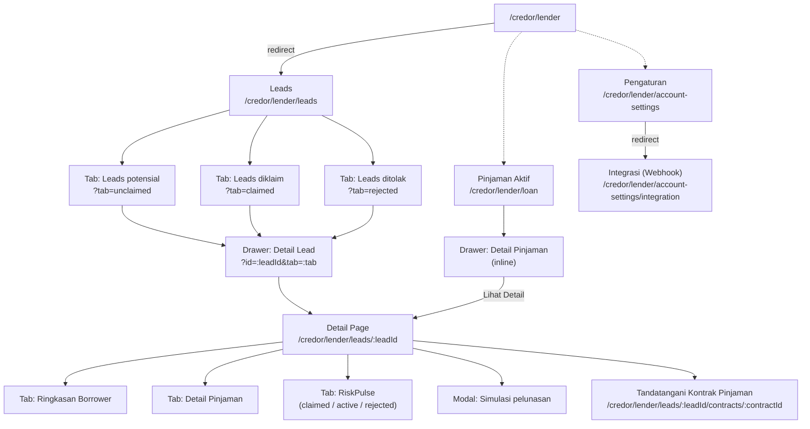
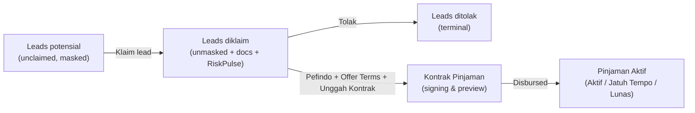

# Credor Lender Portal - Information Architecture & Plan

- **Source**: `https://app.staging-achilles.id/credor/lender`
- **Portal Name**: Lender Portal (`Manage Incoming Deals`)
- **Audited Environment**: Achilles Staging (UI language: Indonesian, sample lender tenant: `Twice Financing`)
- **Audit Scope**: Read-only mapping of global shell, navigation tree, routes, screens, lifecycle states, and integration touchpoints.

---

## 1. Sitemap & Route Hierarchy

### Route Inventory

| Level | Menu / Screen | Path / Query | Entry Point | Notes |
| --- | --- | --- | --- | --- |
| Root | Portal Root | `/credor/lender` | Direct / portal switcher | Redirects to `/credor/lender/leads` |
| L1 | Leads | `/credor/lender/leads` | Sidebar `Leads` | Default tab `?tab=unclaimed`; supports `unclaimed`, `claimed`, `rejected` |
| L2 | Detail Lead (Drawer) | `/credor/lender/leads?id=<leadId>&tab=<tab>` | Row button `Tinjau` | Quick summary + `Lihat detail` / `Klaim lead` |
| L2 | Detail Lead / Pinjaman | `/credor/lender/leads/<leadId>` | Drawer `Lihat detail` | Shared detail route for leads and active loans |
| L3 | Contract Preview / Signing | `/credor/lender/leads/<leadId>/contracts/<contractId>?document_id=<docId>` | Sidebar CTA `Lihat Kontrak` | Contract summary + embedded PDF preview |
| L1 | Pinjaman Aktif | `/credor/lender/loan` | Sidebar `Pinjaman Aktif` | Active portfolio KPIs + loan table |
| L2 | Detail Pinjaman (Drawer) | Inline on `/credor/lender/loan` | Row button `Lihat` | Summary drawer; `Lihat Detail` routes to `/credor/lender/leads/<loanId>` |
| L1 | Pengaturan | `/credor/lender/account-settings` | Sidebar `Pengaturan` | Redirects to `/credor/lender/account-settings/integration` |
| L2 | Integrasi | `/credor/lender/account-settings/integration` | Settings sub-nav `Integrasi` | Webhook docs, Global Settings link, 21-event catalog |

---

## 2. Global Shell & Chrome

### Top Bar (`banner`)
- Right-aligned account/workspace trigger (e.g., `CT CGI Test`).
- Account dropdown contents:
  - Identity block: user name and email.
  - Action: `Ubah profil`.
  - Language switcher (`Bahasa`): `Indonesia` | `Inggris`.
  - Portal switcher: `Achilles` | `Lender portal`.
  - Session action: `Keluar`.
- Not present: global search, notifications bell, or in-app help center.

### Left Sidebar (`navigation`)
- Portal header: **`Lender Portal`** with subtitle **`Manage Incoming Deals`**.
- Flat 3-item primary navigation (no collapsible groups, no unread counters/badges):
  1. `Leads` (`/credor/lender/leads`)
  2. `Pinjaman Aktif` (`/credor/lender/loan`)
  3. `Pengaturan` (`/credor/lender/account-settings/integration`)

### Content Header Indicator
- Persistent lender identity pill displayed at top-right of every Lender Portal screen (e.g., `Twice Financing`).

---

## 3. Screen-by-Screen Information Architecture

### 3.1 Leads (`/credor/lender/leads`)
- **Header**: Title `Leads`, subtitle `Tinjau calon borrower dan peluang pembiayaan`. No breadcrumbs.
- **KPI Summary (1 card)**:
  - `Total Leads`: contextual count for the active tab (subtext: `Perlu Ditinjau dan Diklaim`).
- **Secondary Tabs**:
  1. `Leads potensial` (`?tab=unclaimed`)
  2. `Leads diklaim` (`?tab=claimed`)
  3. `Leads ditolak` (`?tab=rejected`)
- **Filters & Controls**:
  - Single dropdown filter: `Jenis Pinjaman` (`Semua Jenis Pinjaman`, `AP Invoice Financing`, `Free Financing`, `AR Invoice Financing`).
  - No keyword search, column sort, or data export.
- **Table Columns** (consistent across all 3 tabs):
  1. `Tanggal Pengajuan` (date + time `WIB`)
  2. `Nomor Pengajuan` (application code + optional `New` / `Trending` badge)
  3. `Jenis Pinjaman` (`AR Invoice Financing`, `AP Invoice Financing`, etc.)
  4. `Nama Perusahaan` (masked on unclaimed `New` leads, plus country)
  5. `Industri`
  6. `Detail Pinjaman` (`No. Invoice Komersial`, `Counterpart`)
  7. `Estimasi Pinjaman` (IDR)
  8. `Skala Usaha` (`Large`, `Medium`, `N/A`)
  9. Action: `Tinjau` button (opens `Detail Lead` drawer)
- **Pagination**: `Rows per page` (`5`, `10`, `25`, `50`, `75`, `100`), page indicator, First / Previous / Next / Last controls.

#### Slide-Over Drawer: `Detail Lead`
- **URL**: `/credor/lender/leads?id=<leadId>&tab=<tab>`
- **Content blocks**:
  1. Application summary card: `Nomor Pengajuan`, `Estimasi Pinjaman`, `Jenis Pinjaman`.
  2. `Ringkasan Borrower` card: `Skala Usaha`, `Perusahaan`.
  3. Footer / action block:
     - `unclaimed`: `Klaim lead ini?` card with `Tanggal pengajuan`, secondary CTA `Lihat detail`, primary CTA `Klaim lead`.
     - `claimed` / `rejected`: single CTA `Lihat detail`.

---

### 3.2 Lead & Loan Detail (`/credor/lender/leads/<leadId>`)
- **Header**: Back button (`<`), title `Detail`, subtitle `Tinjau calon borrower dan peluang pembiayaan`, lender pill on the right.
- **Top Identity Card**: `Nomor Pengajuan`, `Perusahaan`, `Industri`, `Lokasi`.
- **Two-Column Workspace**:
  - **Left Column**: Tabbed information workspace (`Ringkasan Borrower`, `Detail Pinjaman`, and `RiskPulse`).
  - **Right Column**: State-dependent action & status sidebar.

#### Left Column Tabs

1. **`Ringkasan Borrower`** (all states)
   - **Borrower profile card**: `Skala Usaha`, `NPWP Perusahaan`, `Nama PIC`, `Nomor Telepon`, `Email`, `Pendapatan Tahunan`, `Laba Kotor`.
     - *Unclaimed*: sensitive fields masked with lock icons.
     - *Claimed / Active / Rejected*: fully unmasked.
   - **`Dokumen Pendukung Ringkasan Borrower`**:
     - 5 document categories: `Company Verification`, `Individual Verification`, `Business Verification`, `Financial Verification`, `Post Submission`.
     - *Unclaimed*: category checklist only (downloads locked).
     - *Claimed / Active / Rejected*: `Download All` action + expandable accordions listing individual PDF files (e.g., Akta Pendirian, SK Kemenkumham, NPWP, Akta Perubahan).

2. **`Detail Pinjaman`** (all states)
   - **`Ringkasan pinjaman`**: `Jenis Pinjaman`, `Counterpart` + `NPWP`, `Nomor Invoice` + status chip (`Approved`), `Jatuh tempo`, `e-Faktur` + status chip (`Approved`), `Jumlah Invoice`, `Status Pembayaran` (`Lunas` / `Belum Lunas`).
   - **`Dokumen Pendukung Ringkasan Pinjaman`**:
     - *Unclaimed*: locked state message (`Dokumen lengkap akan tersedia setelah Anda mengklaim borrower ini`).
     - *Claimed / Active*: `Download All` + per-document preview/download rows (`E-Faktur` PDF, `Invoice` PDF, `Transaction` CSV).

3. **`RiskPulse`** (visible once claimed: claimed, active, and rejected leads)
   - **Entity Risk Header**: Company name, rating badge (e.g., `Baik`), `Indeks Risiko` score, `Formula & Skoring Indeks Risiko` trigger, `NPWP`, reporting period (`Pelaporan per`).
   - **6 Pillar KPI Cards**:
     - `Stabilitas Pembelian`
     - `Kualitas Invoice Masuk`
     - `Konsentrasi Vendor`
     - `Stabilitas Penjualan`
     - `Kualitas Invoice Keluar`
     - `Konsentrasi Pembeli`
   - **`Metrik Penilaian`**:
     - `Skor Indikator` table (`Metrik`, `Skor Mentah`, `Persentil`, `Skor Risiko`, `Dalam Indeks`, `Deskripsi`).
     - Category breakdown tables (`Kinerja Bisnis & Stabilitas Transaksi`, `Hubungan Vendor & Risiko Konsentrasi`, `Efektivitas Proses Internal`).
   - **`Referensi Metrik Lengkap`**: 7 full reference tables (`Hubungan Vendor & Risiko Konsentrasi`, `Efektivitas Proses Internal`, `Kinerja Bisnis & Stabilitas Transaksi`, `Integritas Invoice & Kualitas Data`, `Dinamika Counterparty & Churn`, `Integritas Sumber & Kanal`, `Deteksi Anomali Tarif / Basis`).
   - **`Breakdown Bulanan`**: 4 monthly series tables + min/max/avg summary stats.
   - **`Vendor Teratas berdasarkan Pangsa DPP`**: ranked table (`Peringkat`, `Nama Vendor`, `Invoice Pajak`, `Total DPP`, `Pangsa`, `Tingkat Gagal Keras`, `Bulan Aktif`, `Tingkat Risiko`).
   - **`Peta Jaringan Perdagangan`**: toggleable graph (`Grafik Jaringan` | `Grafik Butterfly`), legend (`Pembeli`, `Vendor`), and network summary counts (`Total Pembeli`, `Total Vendor`, `Node Risiko Tinggi`, `Total Koneksi`).

#### Right Column Sidebar by Deal Lifecycle State

| State | Header / Status | Fields & Controls | Actions |
| --- | --- | --- | --- |
| **Unclaimed** (`Leads potensial`) | `Klaim lead ini?` | `Tanggal pengajuan` | `Klaim lead` |
| **Claimed - Pending Offer** (`Pemilihan Kontrak`) | `Nomor Pengajuan` + copy | `Pefindo checking` (`Wajib` checkbox + timestamp); offer form (`Jumlah Persetujuan`, `Payment Method`, `Tenor`, `Suku Bunga (p.a)`, `Biaya Admin`, `Biaya Keterlambatan`); `Ringkasan syarat` + `Bagi hasil (termasuk pajak)` accordion | `Lihat simulasi pelunasan`, `Unggah Kontrak`, `Minta Data`, `Tolak` |
| **Active Loan** (`Aktif`) | `Nomor Pengajuan` + copy | `Pefindo checking`; `Ringkasan syarat` (`Jumlah Persetujuan`, `Tenor`, `Biaya Admin`, `Jumlah Pencairan`, `Payment Method`); expandable `Bagi hasil (termasuk pajak)`; `Pinjaman tertunggak` (`Terakhir disinkronkan`, `Total bunga`, `Denda keterlambatan`, `Jumlah jatuh tempo saat ini`, `Jumlah jatuh tempo pada tanggal jatuh tempo`) | `Lihat simulasi pelunasan` (modal), `Lihat Kontrak` |
| **Rejected** (`Leads ditolak`) | `Anda menolak lead ini` | Static lock notice, `Skor lead`, `Alasan penolakan`, `Ditolak pada` | None (terminal state) |

#### Modal: `Simulasi pelunasan`
- Triggered from `Lihat simulasi pelunasan` on claimed/active leads.
- Displays daily repayment projection table (`Tanggal`, `Bunga`, `Denda`, `Jumlah jatuh tempo`) with quick jump buttons (`Ke hari jatuh tempo`, `Ke hari denda`).

---

### 3.3 Contract Preview / Signing (`/credor/lender/leads/<leadId>/contracts/<contractId>`)
- **Header**: Back button, title `Tandatangani Kontrak Pinjaman`, lender pill.
- **Summary Card**: `Informasi Borrower`, `Produk`, `Ringkasan Pinjaman` (including expandable `Bagi hasil (termasuk pajak)`), `Informasi Agunan` (Invoice & e-Faktur).
- **`Pratinjau Kontrak`**: Multi-contract tab strip (e.g., `Kontrak 1`), contract status (`Status: Ditandatangani`), and embedded PDF viewer toolbar (download, zoom, page controls).

---

### 3.4 Pinjaman Aktif (`/credor/lender/loan`)
- **Header**: Title `Pinjaman Aktif`, subtitle `Pantau pinjaman aktif yang berjalan dan lacak progres pelunasan di seluruh portofolio Anda.`.
- **KPI Cards (4 cards)**:
  1. `Total Pinjaman Aktif` (count, subtext `Kelola Semua Pinjaman`)
  2. `Total Nilai Pinjaman Aktif` (IDR total, subtext `Di seluruh borrower`)
  3. `Jatuh Tempo` (count needing action, subtext `Perlu tindakan segera`)
  4. `Jatuh Tempo Terdekat` (nearest due date)
- **Filters & Controls**: None currently implemented (no search, status filter, sort, or export).
- **Table Columns**:
  1. `Tanggal Pengajuan` (date + relative age)
  2. `Nomor Pengajuan`
  3. `Nama Perusahaan`
  4. `Tanggal Jatuh Tempo`
  5. `Jumlah Disetujui`
  6. `Jumlah Pencairan`
  7. `Jenis Pinjaman` (product + sub-type, e.g., `AR Invoice Financing` / `Enterprise Financing`)
  8. `Status` (`Aktif`, `Lunas`, `Jatuh Tempo`)
  9. Action: `Lihat` button (opens `Detail Pinjaman` drawer)
- **Pagination**: `Rows per page`, page indicator, First / Previous / Next / Last buttons.

#### Slide-Over Drawer: `Detail Pinjaman`
- Opens inline on `/credor/lender/loan`.
- Displays `Jumlah Permohonan`, `Jumlah Pencairan`, `Jenis Pinjaman`, `Sub Jenis`, `Ringkasan Pinjaman`, and CTA `Lihat Detail` (navigates to `/credor/lender/leads/<loanId>`).

---

### 3.5 Pengaturan - Integrasi (`/credor/lender/account-settings/integration`)
- **Header**: Title `Pengaturan`, subtitle `Kelola informasi Anda dan konfigurasikan pengaturan.`.
- **Left Sub-Navigation**: 1 item (`Integrasi`).
- **Main Card: `Webhook`** (`Terima notifikasi kejadian secara real-time ke server Anda`):
  - **Documentation row**: `Unduh dokumentasi` CTA (lender webhook API guide).
  - **Configuration row**: `Kelola Webhook` external-link CTA pointing to Achilles Global Settings.
  - **Events Catalog Table** (`Nama event`, `Tujuan`) with **21 events** across 5 domains:
    - **Application lifecycle (4)**: `FINANCING_APPLICATION_SUBMITTED`, `FINANCING_APPLICATION_CLAIMED`, `FINANCING_APPLICATION_DOCUMENT_UPDATED`, `FINANCING_APPLICATION_REJECTED`
    - **Offer & Contract (4)**: `FINANCING_OFFER_SENT`, `FINANCING_OFFER_ACCEPTED`, `FINANCING_OFFER_REJECTED`, `FINANCING_CONTRACT_SIGNED`
    - **Disbursement (3)**: `FINANCING_DISBURSEMENT_PROCESSED`, `FINANCING_DISBURSEMENT_DISBURSED`, `FINANCING_DISBURSEMENT_FAILED`
    - **Collateral & Repayment (4)**: `FINANCING_COLLATERAL_PAID`, `FINANCING_REPAYMENT_PROCESSED`, `FINANCING_REPAYMENT_DISBURSED`, `FINANCING_REPAYMENT_FAILED`
    - **Collateral Invoice / PPN Changes (6)**: `FINANCING_COLLATERAL_COMMERCIAL_INVOICE_APPROVED`, `FINANCING_COLLATERAL_COMMERCIAL_INVOICE_CANCELLED`, `FINANCING_COLLATERAL_COMMERCIAL_INVOICE_REPLACED`, `FINANCING_COLLATERAL_COMMERCIAL_INVOICE_EDIT`, `FINANCING_COLLATERAL_PPN_INVOICE_REPLACED`, `FINANCING_COLLATERAL_PPN_INVOICE_CANCELLED`

---

## 4. End-to-End Deal Lifecycle Flow

---

## 5. IA Gaps & Redesign Plan Considerations

Findings from the staging audit that should inform any redesign or prototype plan:

1. **Shared Detail Route Context Break**: Clicking `Lihat Detail` from `Pinjaman Aktif` (`/credor/lender/loan`) navigates to `/credor/lender/leads/<loanId>`, switching the active sidebar highlight back to `Leads` and keeping the `Tinjau calon borrower dan peluang pembiayaan` subtitle. Consider dedicated `/credor/lender/loan/<loanId>` routing (or context-aware breadcrumbs + sidebar highlight) for active loans.
2. **Missing List Discovery Controls**:
   - `Leads` has only a `Jenis Pinjaman` filter (no keyword search by company/application number, date range, or sort).
   - `Pinjaman Aktif` has no search, status filter (`Aktif` / `Jatuh Tempo` / `Lunas`), sort, or CSV export despite showing overdue KPI counts (`Jatuh Tempo: 20`).
3. **KPI Card Ambiguity on Leads**: The single `Total Leads` card always displays subtext `Perlu Ditinjau dan Diklaim`, even when viewing `Leads diklaim` or `Leads ditolak`.
4. **Heavy RiskPulse Tab Density**: The `RiskPulse` tab on the detail screen stacks 6 KPI cards, 10+ metric/reference tables, 4 monthly breakdowns, top vendors, and a network graph in a single column alongside the sticky right sidebar. Consider sub-navigation/chapter anchors or progressive disclosure (similar to the RiskPulse executive summary pattern).
5. **Narrow-Column Overflow on Detail Cards**: In the two-column detail layout, the left `Ringkasan Borrower` tab bar clips adjacent tabs and 3-column metadata grids (`NPWP Perusahaan`, `Nama PIC`, `Nomor Telepon`) can crowd at standard desktop widths.
6. **Single-Item Settings Sub-Nav**: `Pengaturan` renders a left sub-nav column containing only `Integrasi`, while webhook management itself redirects out to Achilles Global Settings. Clarify whether additional lender settings (team, product terms, disbursement accounts, notification preferences) are planned here or if the sub-nav can be simplified.
