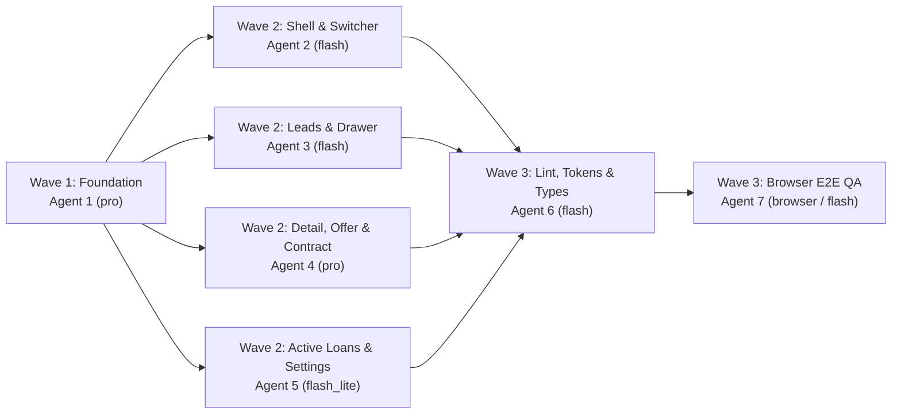

# Plan: Recreate Credor Lender Portal (Multi-Agent Breakdown)

> **Phase 1 Goal**: Recreate the staging Credor Lender Portal (`https://app.staging-achilles.id/credor/lender`) inside this Vue 3 + TypeScript + ACH Design System prototype, accessible from the top-right avatar switcher (`Achilles` ↔ `Lender Portal`), **before** integrating the Phase 2 Risk Pulse enhancements.
>
> **Reference IA**: [credor-lender-ia.md](./credor-lender-ia.md)

---

## Locked Scope Decisions (Confirmed)

| Area | Decision |
| --- | --- |
| **UI Language** | **English** (consistent with the rest of this prototype: `Leads`, `Potential Leads`, `Claimed Leads`, `Rejected Leads`, `Active Loans`, `Settings`, `Integrations`, `Claim lead`, `Borrower Summary`, `Loan Details`) |
| **RiskPulse Tab (Phase 1)** | **Clean placeholder** on claimed/active/rejected detail views (ready for Phase 2 Risk Pulse integration & redesign across Leads, Detail, and Active Loans) |
| **Interactivity** | **Interactive in-memory state**: claiming unmasks borrower/docs and moves lead to `Claimed Leads`; rejecting records reason and moves to `Rejected Leads`; Pefindo check & offer terms live-calculate disbursement, revenue share (incl. tax), and daily `Repayment Simulation` modal; contract preview works end-to-end |
| **Staging UX Fixes** | Included in Phase 1: opening a loan from `Active Loans` preserves the `Active Loans` sidebar highlight and back target; `Leads` KPI card subtext adapts per tab; detail tabs and metadata grids stay responsive without clipping/overlap |

---

## 1. Entry & Navigation Flow (Reproducing Staging)

1. User starts in the existing Achilles / Credor Borrower workspace (`/`).
2. User clicks the **top-right avatar** in `src/components/layout/TopBar.vue`.
3. Dropdown opens showing user identity, language indicator, and portal switcher (**Achilles** | **Lender Portal**).
4. Selecting **Lender Portal**:
   - Switches the sidebar to `LenderSidebar.vue` (`Lender Portal` / `Manage Incoming Deals`, with `Leads`, `Active Loans`, `Settings`).
   - Lands on **Leads** (`#/lender/leads`, default tab `Potential Leads`).
   - Preserves the same top-right avatar dropdown so the user can switch back to **Achilles** at any time.

---

## 2. Multi-Agent Execution Breakdown & Model Tiers

Work is split into **3 waves** with strict file ownership so parallel agents never collide. Complex state/form/architecture work uses a stronger model (`pro` / `inherit`); self-contained CRUD/layout screens use lighter models (`flash` / `flash_lite`).

### Wave 1 - Foundation & Shared State *(Sequential Prerequisite)*

#### Agent 1 - Portal Architect & Data Layer (`Model: pro`)
- **Why `pro`**: Defines all shared TypeScript interfaces, routing contracts, interactive state transitions (claim/reject/offer/repayment calculation), and design-system conventions that all Wave 2 agents depend on.
- **Files owned**:
  - `src/composables/useAppView.ts` (add lender views: `lender-leads`, `lender-lead-detail`, `lender-contract`, `lender-loans`, `lender-settings` + hash persistence `#/lender/...` + `activePortal` helper).
  - `src/lib/lender/types.ts` (typed models for leads, lifecycle states, borrower docs, collateral invoice/e-Faktur, offer terms, repayment schedule rows, active loans, webhook events).
  - `src/lib/lender/lender-data.ts` (realistic Indonesian SME/corporate sample leads across unclaimed/claimed/rejected + active loans + 21 staging webhook events).
  - `src/lib/lender/useLenderPortal.ts` (reactive state store: `claimLead`, `rejectLead`, `togglePefindo`, `saveOffer`, `computeRepaymentSchedule`, `computeRevenueShare`).
  - `src/components/lender/LenderPageHeader.vue` (shared header bar with title, subtitle, optional back button, and lender identity pill).

---

### Wave 2 - Parallel Screen Implementation *(4 Agents in Parallel)*

#### Agent 2 - Avatar Portal Switcher & Lender Shell (`Model: flash`)
- **Why `flash`**: Focused UI integration with Reka UI `DropdownMenu` and existing `Sidebar` primitives.
- **Files owned**:
  - `src/components/layout/TopBar.vue` (convert static avatar `` into an interactive account dropdown with portal switcher: `Achilles` | `Lender Portal`, user info, keyboard/focus handling).
  - `src/components/lender/LenderSidebar.vue` (`Lender Portal` / `Manage Incoming Deals`, 3 primary nav items using verified `public/icons/` assets).
  - `src/components/layout/AppWorkspace.vue` (mount `LenderSidebar` + lender views when `activePortal === 'lender'`, keeping borrower chrome out of the way).

#### Agent 3 - Leads Table & Slide-Over Drawer (`Model: flash`)
- **Why `flash`**: Standard list/filter/table/drawer composition built on existing `Pagination`, `Button`, and `Dialog` primitives.
- **Files owned**:
  - `src/components/lender/LenderLeadsPage.vue` (contextual KPI card, 3 tabs `unclaimed`/`claimed`/`rejected`, `Loan Type` filter, 9-column table with masked company names on unclaimed leads, `New`/`Trending` chips, pagination).
  - `src/components/lender/LenderLeadDrawer.vue` (slide-over quick review drawer with summary card, borrower snapshot, `View Detail` and `Claim Lead` actions).

#### Agent 4 - Lead/Loan Detail Workspace, Offer Sidebar & Contract (`Model: pro`)
- **Why `pro`**: Most complex screen in the portal: 4 lifecycle states in the right sidebar, live financial calculations (interest, admin fee, disbursement net, revenue share + PPh/PPN tax split, daily repayment simulation), masked vs unmasked document accordions, and contract preview.
- **Files owned**:
  - `src/components/lender/LenderLeadDetailPage.vue` (top identity card, left tabs `Borrower Summary` / `Loan Details` / `RiskPulse` placeholder or baseline tab, document accordions & download feedback via `useSnackbar`).
  - `src/components/lender/LenderOfferSidebar.vue` (all 4 states: Unclaimed claim card; Claimed offer terms form with `Pefindo checking`, `%`/`Rp` unit switches, revenue share accordion, Upload Contract / Request Data / Reject dialogs; Active Loan overdue summary; Rejected state card).
  - `src/components/lender/LenderRepaymentModal.vue` (daily repayment schedule modal with jump-to-due-date and jump-to-penalty-day actions).
  - `src/components/lender/LenderContractPage.vue` (contract summary, multi-contract tabs, signed status, document preview card).

#### Agent 5 - Active Loans & Settings / Webhook Integration (`Model: flash_lite`)
- **Why `flash_lite`**: Straightforward read-only tables, KPI cards, slide-over summary drawer, and static webhook catalog with minimal logic.
- **Files owned**:
  - `src/components/lender/LenderLoansPage.vue` (4 portfolio KPI cards, active loans table with `Aktif` / `Jatuh Tempo` / `Lunas` badges, pagination).
  - `src/components/lender/LenderLoanDrawer.vue` (inline `Detail Pinjaman` drawer routing to full detail).
  - `src/components/lender/LenderSettingsPage.vue` (`Integrasi` sub-nav, Webhook card with docs download toast, Global Settings link, 21-event reference table).

---

### Wave 3 - Verification & Visual QA *(Sequential Polish)*

#### Agent 6 - Static Audit, Token Guard & Fixes (`Model: flash`)
- Runs `pnpm check` (`node scripts/lint-tokens.mjs && oxlint src && vue-tsc -b`).
- Verifies zero raw color literals, zero unapproved arbitrary Tailwind classes, zero invented/external icons (all icons verified in `public/icons/`), and tabular numerals on financial figures.

#### Agent 7 - End-to-End Browser Verification (`browser` subagent, `Model: flash`)
- Reproduces the exact user flow on the local Vite server:
  1. Open Achilles Home → click top-right avatar → select **Lender Portal**.
  2. Verify Leads tabs, `Jenis Pinjaman` filter, `Tinjau` drawer, and `Klaim lead` transition.
  3. Open Detail page → verify unmasked borrower/loan tabs, `Pefindo checking`, offer calculator, `Simulasi pelunasan` modal, and `Lihat Kontrak`.
  4. Verify `Pinjaman Aktif` KPIs, table, and `Detail Pinjaman` drawer.
  5. Verify `Pengaturan > Integrasi` webhook catalog.
  6. Click top-right avatar → switch back to **Achilles**.

---

## 3. Shared Guardrails for Every Agent

- **Design Tokens**: Strictly use tokens from `src/styles/tokens/` (`primitives.css` → `semantic.css` → `components.css`); run `pnpm lint:tokens`.
- **Assets**: Only use icons/logos that exist under `public/icons/` and `public/logo/`. Report any missing icon instead of drawing inline SVGs.
- **Primitives**: Reuse existing `Button`, `Dialog`, `Accordion`, `Checkbox`, `Input`, `Pagination`, `Alert`, `Snackbar`, and `reka-ui` primitives.
- **Financial formatting**: Use `font-variant-numeric: tabular-nums` and `Rp` dot-thousands formatting consistently.
- **No regressions**: Existing Borrower / RiskPulse / Consent / Sales flows must remain intact.

---

## 4. Phase 2 Preview *(After Phase 1 Sign-Off)*

Once the base Lender Portal matches staging and is verified, Phase 2 layers in the Risk Pulse integrations:
1. Pre-claim Risk Pulse band/score + filter on `Leads` table & `Detail Lead` drawer.
2. Persistent Risk Pulse summary in Detail header + right offer sidebar + **Counterpart Risk Pulse** on `Detail Pinjaman`.
3. Executive-first `RiskPulse` tab layout (reusing existing `RiskGauge`, `RiskScoreHead`, `RiskFactorRow`, `RiskIndicatorList`).
4. Early-warning Risk Pulse score + trend delta on `Pinjaman Aktif` and risk webhook events on `Integrasi`.
